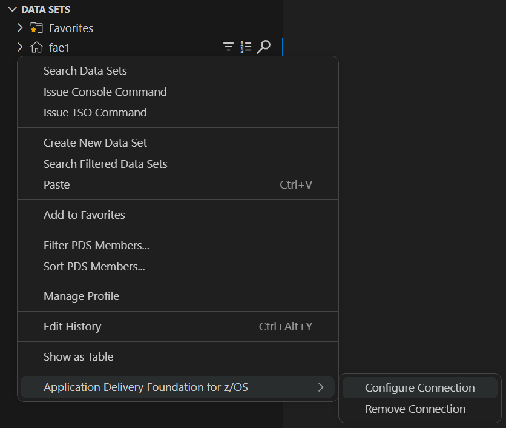
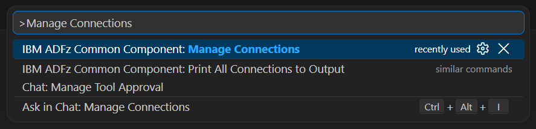

<!--suppress HtmlDeprecatedAttribute, HtmlUnknownTarget -->
<div align="center">

# IBM ADFz Common Component for z/OS&reg;

[][common-component]
[][extension-pack]
[][support]

</div>

Provides shared functionality to VS Code extensions that access [Fault Analyzer][fault-analyzer]
and [File Manager][file-manager] for z/OS resources.

The IBM ADFz Common Component extension enables centralized credential storage for the Fault Analyzer and File Manager extensions,
and offers menu options to configure ADFz Common Component connections, streamlining setup across products.

## Table of contents

- [Requirements](#requirements)
- [Integration with Zowe Explorer](#integration-with-zowe-explorer)
- [ADFz Common Component connections](#adfz-common-component-connections)
  - [Configure a connection](#configure-a-connection)
  - [Configure a connection in `zowe.config.json`](#configure-a-connection-in-zoweconfigjson)
  - [Remove an existing connection](#remove-an-existing-connection)
- [Getting help](#getting-help)

## Requirements

### General requirements

- Assumes knowledge of how to [install][cc-install] and [configure][cc-config] the ADFz Common Component server.
- [ADFz Common Component][cc-customize] must use the [AT-TLS][cc-attls] feature when configuring TLS support.

### Host requirements

- [IBM Application Delivery Foundation for z/OS&reg; Common Component][cc-docs] `1.10.0`+
  - You must configure and deploy at least one ADFz Common Component server on the host you intend to use with the extension.

### VS Code requirements

- [VS Code][vscode] `1.108.0`+
- [Zowe Explorer][zowe] `3.2.0`+
  - Assumes the user is familiar with the Zowe Explorer extension before using the IBM ADFz Common Component extension.

## Integration with Zowe Explorer

The IBM ADFz Common Component extension builds on the strong foundation provided by Zowe Explorer.
To preserve the familiar Zowe Explorer user experience, it purposefully avoids contributing highly
customized UI elements whenever possible. Instead, it enhances your current workspace by:

- Mapping ADFzCC connections to your Zowe profiles.
- Adding new functionality directly to Zowe Explorer's existing views.

See the [Getting help](#zowe-explorer-issues) section to report issues related to the Zowe Explorer extension.

## ADFz Common Component connections

The extension associates an ADFz Common Component server connection with a compatible Zowe profile.
The connection configuration includes the server host (inferred from the associated Zowe profile),
the server port, username, password or pass token, and whether to start the server connection in debug mode.

### Configure a connection

1. Open the Zowe Explorer tool window.
2. Right-click the Zowe profile that matches the z/OS subsystem where the ADFz Common Component server runs.
3. Select **Application Delivery Foundation for z/OS** > **Configure connection**.
4. Enter the ADFz Common Component server port, username, password or pass token, and debug mode.

<p align="center">
  
  <br>
  <small>The ADFz context menu</small>
</p>

Alternatively, you can configure a connection from the command palette by running **IBM ADFz Common Component: Manage Connections**,
selecting a compatible Zowe profile, and choosing **Configure Connection**.

<p align="center">
  
  <br>
  <small>The Manage Connections palette command</small>
</p>

### Configure a connection in `zowe.config.json`

> **Important:** this is an experimental feature

You can specify the ADFz Common Component server port and debug mode in a Zowe team configuration profile.
Add an `adfzcc` object under the profile's `properties` object:

```json
{
  "profiles": {
    "my-profile": {
      "type": "zosmf",
      "properties": {
        "host": "zosmf.example.com",
        "port": 443,
        "adfzcc": {
          "port": 2860,
          "debug": false
        }
      }
    }
  }
}
```

When `adfzcc.port` or `adfzcc.debug` is specified, the extension uses that value instead of prompting for it.
User credentials are still requested when they are not already available.

### Remove an existing connection

1. Right-click the Zowe profile with the ADFz Common Component connection.
2. Select **Application Delivery Foundation for z/OS** > **Remove connection**.
3. Confirm the removal.

Alternatively, you can remove a connection from the command palette by running **IBM ADFz Common Component: Manage Connections**,
selecting the configured profile, and choosing **Remove Connection**. Removing a connection also removes its linked resources.

## Getting help

To ask questions or report issues related to the installation, configuration,
or use of this extension, contact [IBM Support][support].

### Zowe Explorer issues

The IBM ADFz Common Component extension depends on Zowe Explorer.  
Issues might originate from core Zowe Explorer functionality rather than the extension itself.
Examples include:

- Data set and Unix System Services (USS) file browsing
- Job management and submission
- Base Zowe Explorer commands and views

Report issues that are specific to Zowe Explorer to the Zowe Explorer [issue tracker][zowe-support].

To determine the source of an issue and the appropriate reporting channel, consider the following:

- Error notifications include the extension name.
- Log entries displayed in the **Output** view are categorized by extension.

[fault-analyzer]: https://marketplace.visualstudio.com/items?itemName=IBM.zfaultanalyzer
[file-manager]: https://marketplace.visualstudio.com/items?itemName=IBM.zfilemanager
[common-component]: https://marketplace.visualstudio.com/items?itemName=IBM.zcommoncomponent
[extension-pack]: https://marketplace.visualstudio.com/items?itemName=IBM.application-delivery-foundation-for-zos-vscode-extension-pack
[vscode]: https://code.visualstudio.com
[zowe]: https://marketplace.visualstudio.com/items?itemName=Zowe.vscode-extension-for-zowe
[cc-docs]: https://help.blueproddoc.com/adfz_common_components/welcome/index.html
[cc-install]: https://help.blueproddoc.com/adfz_common_components/hvwr1a0_ADFzCC_Program_Directory_V1.10.pdf
[cc-config]: https://help.blueproddoc.com/adfz_common_components/1.10.0/en/index.html
[cc-customize]: https://help.blueproddoc.com/adfz_common_components/1.10.0/en/svrauth.html
[cc-attls]: https://help.blueproddoc.com/adfz_common_components/1.10.0/en/attls.html
[support]: https://www.ibm.com/mysupport/
[zowe-support]: https://github.com/zowe/zowe-explorer-vscode/issues
